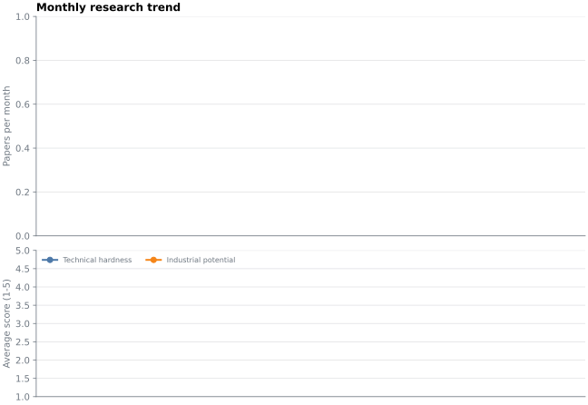

# Awesome Physical AI

A daily, automatically updated tracker of new arXiv papers on **Robotics / Human-in-the-loop /
Industrial RL**. Each paper is summarised by an LLM and scored from 1 to 5 on **technical
hardness** and **industrial potential**.

<!-- PAPERS:START -->
> Last updated: 2026-11-16 (UTC) · 0 papers tracked · Model: `claude-opus-5-5`

## 📈 Trends

_No data yet. Waiting for the first run._
<!-- PAPERS:END -->

## Methodology

The pipeline runs daily via GitHub Actions in four stages: **Collection → Assessment → Ranking → Aggregation**. All configurable parameters are defined in [`tracker/config.py`](tracker/config.py).

### 1. Paper Collection

Three queries are executed against the arXiv API, sorted by submission date (newest first):

| Topic | Categories | Abstract Filter | Fetch Cap |
| :--- | :--- | :--- | :---: |
| **Robotics** | `cs.RO` *(primary or cross-listed)* | *None* | 100 |
| **Human-in-the-loop** | `cs.RO`, `cs.LG`, `cs.AI`, `cs.HC` | `"human-in-the-loop"` OR `"human in the loop"` OR `"interactive imitation learning"` OR `"shared autonomy"` | 30 |
| **Industrial RL** | `cs.LG`, `cs.RO`, `cs.AI`, `eess.SY` | `"reinforcement learning"` **AND** (`"industrial"` OR `"manufacturing"` OR `"factory"` OR `"process control"`) | 30 |

* **Deduplication:** Papers are deduplicated by base arXiv ID (version suffix stripped); multi-query hits retain all matched topic tags.
* **Daily assessment cap:** At most **50** previously unseen papers are scored per run. When more are available, candidates are selected round-robin across the three topics (newest first within each topic).

---

### 2. LLM Assessment

Each paper is evaluated independently in a single LLM call using only its **title, abstract, primary category, and matched topics** (full text is not read). The exact prompt is located in [`tracker/llm.py`](tracker/llm.py). Failed calls remain unscored and are retried on the next run.

#### Output Schema (JSON)

| Field | Type / Range | Description |
| :--- | :--- | :--- |
| `summary` | `string` | 2–3 sentence summary covering problem, method, and result. |
| `technical_hardness` | $H \in \lbrace 1, 2, 3, 4, 5 \rbrace$ | Ordinal score for methodological depth and novelty. |
| `industrial_potential` | $I \in \lbrace 1, 2, 3, 4, 5 \rbrace$ | Ordinal score for proximity to real-world deployment. |
| `category` | `enum` (8 classes) | Assigned solely from paper content, independent of retrieval query. |
| `rationale` | `string` | One sentence citing the primary evidence for both scores. |

#### Scoring Rubric

Both dimensions use a 5-point ordinal scale anchored at **1, 3, and 5** (scores of **2** and **4** interpolate between adjacent anchors). To mitigate score inflation, the prompt instructs the model to place most papers in the **2–4** range, reserve **1** and **5** for strong evidence, and score ambiguous abstracts conservatively.

| Score | Technical Hardness ($H$): *Depth & Novelty* | Industrial Potential ($I$): *Deployment Readiness* |
| :---: | :--- | :--- |
| **1** | Survey, position paper, or straightforward application of an existing method. | Purely theoretical, or validated only in toy environments. |
| **3** | Solid incremental work with clear methodological improvement and comparative experiments. | Validated on real robots or realistic simulation; deployment still requires substantial engineering. |
| **5** | New paradigm, or rigorous theoretical guarantees backed by large-scale real-world validation. | Validated in a real industrial setting while addressing deployment constraints (safety, cost, reliability, cycle time). |

#### Closed Taxonomy

`Manipulation` · `Locomotion & Navigation` · `Foundation Models / VLA` · `Human-in-the-loop` · `Industrial RL & Control` · `Simulation & Sim2Real` · `Perception & Mapping` · `Other`

---

### 3. Ranking & Aggregation

* **Composite score:** $S = H + I \in [2, 10]$, weighting both dimensions equally.
* **Top 10:** Papers published within the 7-day window ending on the latest publication date are ranked by $S$ descending, with ties broken by higher $I$.
* **Monthly trend:** Papers are grouped by publication month to report category counts alongside the arithmetic means of $H$ and $I$.

---

## Limitations

> [!NOTE]
> Please interpret scores and trends with the following methodological constraints in mind:
> * **Abstract-only evidence:** Scores reflect claims made in the abstract rather than an audit of the full paper, experimental rigor, or code.
> * **Single automated rater:** Ratings come from a single LLM without human expert calibration or inter-rater reliability checks; re-running the same paper may shift a score by $\pm 1$ point.
> * **Ordinal scale:** $H$ and $I$ are ordinal variables, meaning $S$ and monthly arithmetic means serve as descriptive summaries rather than strict interval measurements.
> * **Sampling bias:** Keyword filters trade recall for precision (off-topic hits are typically tagged `Other`), and the daily cap samples `cs.RO` rather than covering it exhaustively. Monthly counts therefore reflect the tracked sample, not the entire field.
